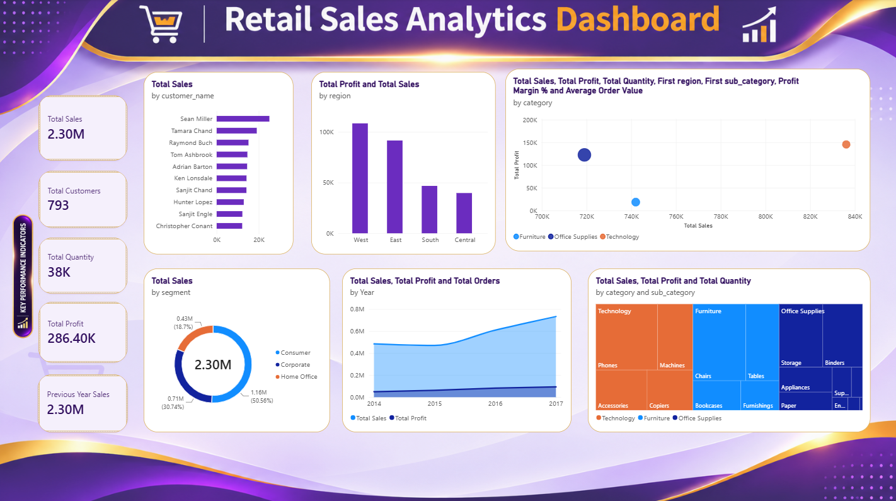

# Retail Sales Analytics Dashboard 📊

An end-to-end Data Analytics project focused on analyzing retail sales performance, customer behavior, product profitability, and business trends using Python, SQL, PostgreSQL, Power BI, and DAX.

## 📌 Project Overview

The objective of this project is to transform raw retail sales data into meaningful business insights through data cleaning, exploratory data analysis, SQL queries, and interactive Power BI visualizations.

## 🎯 Project Objectives

- Analyze overall sales and profitability.
- Identify top-performing products and categories.
- Understand customer purchasing patterns.
- Compare regional sales performance.
- Analyze yearly sales trends.
- Evaluate the impact of discounts on profitability.
- Build an interactive Power BI dashboard.

## 🛠️ Tools & Technologies

| Technology | Usage |
|---|---|
| Python | Data Cleaning and EDA |
| Pandas | Data Manipulation |
| SQL | Data Exploration and Business Analysis |
| PostgreSQL | Database Management |
| pgAdmin 4 | SQL Query Execution |
| Power BI | Interactive Dashboard |
| DAX | KPI Calculations |

## 📂 Project Structure

```text
Retail_Analytics/
│
├── Dataset/
│   ├── Sample - Superstore.csv
│   └── superstore_clean.csv
│
├── Data_Analysis/
│   └── Data_cleaning_checkpoint.ipynb
│
├── SQL/
│   └── retail_analytics.sql
│
├── PowerBI/
│   ├── Retail_Sales_Analytics_Dashboard.pbix
│   └── Dashboard_Screenshot.png
│
├── Documentation/
│   └── Project_Insights.docx
│
├── README.md
```

## 📊 Key Performance Indicators

| KPI | Value |
|---|---:|
| Total Sales | $2.30M |
| Total Profit | $286.40K |
| Total Customers | 793 |
| Total Quantity Sold | 38K |

## 🔍 Analysis Performed

### 1. Python – Data Cleaning & EDA
- Dataset exploration and inspection.
- Missing value and duplicate checks.
- Data preprocessing using Pandas.
- Exploratory Data Analysis.

### 2. SQL – Business Analysis
- Data exploration and validation.
- Business KPI calculations.
- Sales and profitability analysis.
- Customer and product analysis.
- Regional and shipping analysis.
- Discount analysis.
- SQL aggregations and window functions.

### 3. Power BI – Dashboard Development
- KPI cards.
- Top customers by sales.
- Regional sales and profit comparison.
- Customer segment analysis.
- Year-wise sales trends.
- Category and sub-category performance.

## 💡 Key Business Insights

- Consumer segment contributes approximately 50.56% of sales.
- Corporate contributes approximately 30.74%.
- Home Office contributes approximately 18.70%.
- West region has the highest sales among the regions displayed.
- Sales show an overall upward trend from 2014 to 2017.

## 📸 Dashboard Preview



## 🚀 How to Explore the Project

1. Clone or download this repository.
2. Explore the `Dataset` folder.
3. Open the Jupyter Notebook inside `Data_Analysis`.
4. Execute the SQL queries using PostgreSQL and pgAdmin 4.
5. Open the `.pbix` file using Power BI Desktop.
6. Explore the interactive dashboard.

## 📚 Documentation

For detailed project insights and analysis:

- [Project Insights – Word](Documentation/Project_Insights.docx)

## 🎓 Key Learnings

- End-to-end data analytics workflow.
- Python-based data cleaning and EDA.
- SQL and PostgreSQL business analysis.
- DAX measures and Power BI visualization.
- Business insights and data-driven decision-making.
